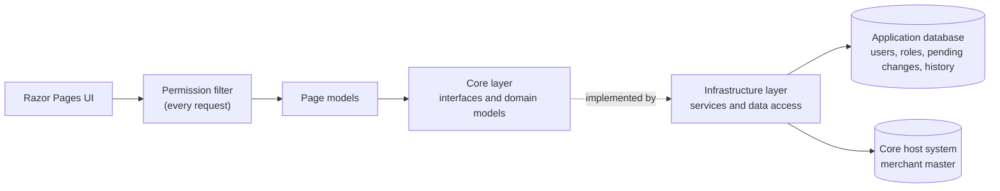
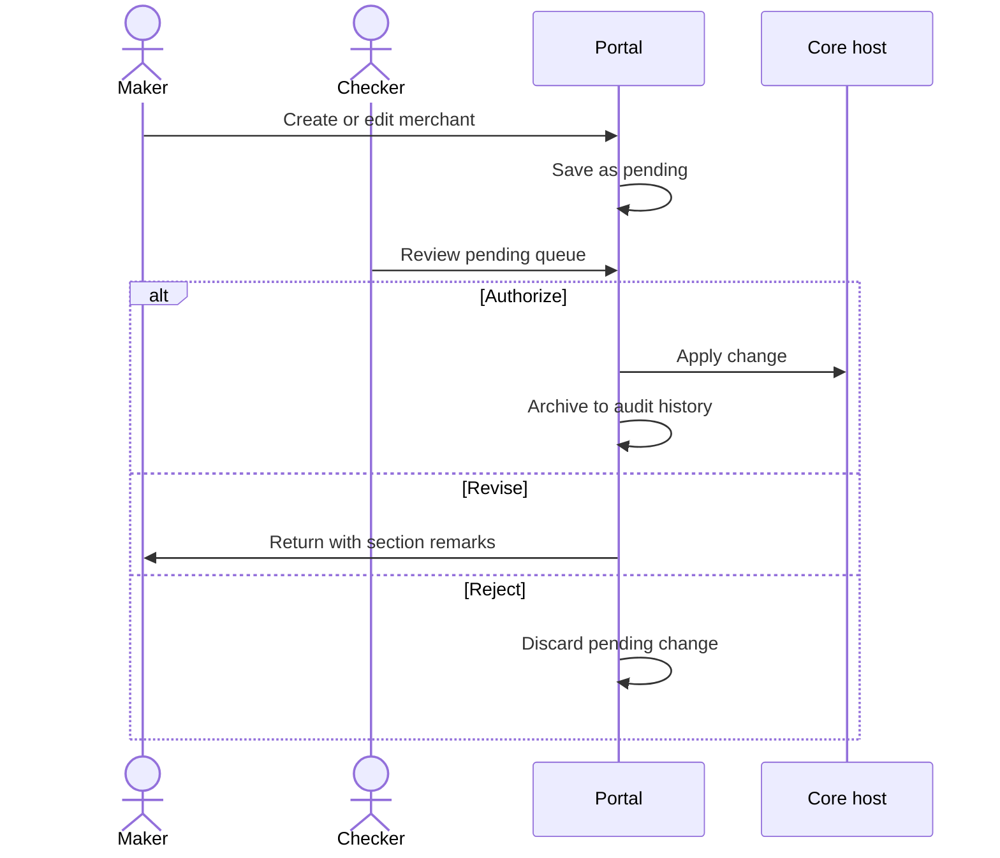

# WEBIMS: Web Merchant Integration System

**A banking back-office platform for onboarding and maintaining card-accepting merchants, with a maker-checker (four-eyes) approval workflow, role-based access control, audit history and automated settlement scheduling. Migrated from .NET Framework to .NET 10.**

> **About this repository**
> This project was built in a professional setting and its source code is the property of my employer. This repository is a **portfolio write-up only**: it contains no source code, no client data and no internal system details. Names, figures and workflows are described at a general level.

---

## Overview

Banks that let businesses accept card payments (merchant acquiring) must register each merchant, its terminals, its commission terms and its risk settings in a core host system. Changes to that data affect real money, so every change needs a second person to approve it.

This portal is the web front end that operations staff and supervisors use every day for that work. I worked on **migrating it from a legacy ASP.NET Web Forms application on .NET Framework to ASP.NET Core Razor Pages on .NET 10**, with a clean layered architecture, while staying fully compatible with the bank's existing databases and core host programs.

## My Role

- Led the migration from .NET Framework Web Forms to ASP.NET Core, including the later upgrade to .NET 10.
- Designed the layered solution structure and service boundaries.
- Re-implemented the maker-checker, revision, access-control, audit and settlement-scheduling workflows.
- Preserved the contracts and data formats of the core host integration.
- Built the UI and design system, and handled deployment and production support.

## Key Features

| Area | Capability |
|---|---|
| **Merchant management** | Create, search, view and edit merchants and their terminals through a tabbed form (details, contact, commission terms, account, risk profile) |
| **Maker-checker workflow** | Every change is parked as pending until a second user authorizes or rejects it; makers can never approve their own work |
| **Revise with remarks** | Checkers can send a record back, flagging which sections need correction with comments, and the maker resubmits |
| **Settlement scheduling** | Enable automatic settlement per merchant and set daily settlement times, with every host call logged |
| **Access control** | Path-based permissions enforced on every request, with navigation generated from the user's permissions |
| **Administration** | Users, roles, role permissions and participating institutions, each under the same approval workflow |
| **Audit log** | Filterable history of every merchant change, exportable to Excel and text for compliance teams |
| **Risk profiles** | Assign a standard risk profile or define custom limits per merchant |
| **Account security** | Lockout after repeated failures, forced password change, password history, idle timeout, security headers |
| **Intranet ready** | All assets self-hosted, no internet dependency |

## Tech Stack

| Area | Technology |
|---|---|
| Runtime | .NET 10, C# (migrated from .NET Framework 4.6) |
| Web | ASP.NET Core Razor Pages, view components, page filters |
| Data access | Entity Framework Core for reference data; ADO.NET with explicit transactions for workflow operations |
| Core host | IBM i (AS/400) DB2 via ODBC and host stored procedures |
| Database | Microsoft SQL Server |
| Logging | Serilog |
| Export | Excel generation library, delimited text |
| Front end | Bootstrap 5, Bootstrap Icons, jQuery Validation, CSS design tokens |
| Hosting | IIS on Windows Server behind a reverse proxy |

## Architecture

A **three-project clean architecture**: the web layer depends only on interfaces in the core layer, and the infrastructure layer implements them.

### Maker-checker flow

## Engineering Highlights

- **Modernization without a data migration.** Reused the existing database schema and core host programs, so the new app could run alongside the old one and switch over with no data conversion.
- **Exact compatibility with the core host.** Reproduced the legacy field formats, numeric conversions and date layouts precisely, verified against real records.
- **Right tool per job in data access.** EF Core for simple mapped data; hand-written ADO.NET with explicit transactions where ordering and database triggers matter.
- **Intranet performance fixes.** Removed external font and CDN dependencies that caused 20 to 30 second page-load stalls on machines without internet access, and moved one-time data seeding out of application start-up.
- **Production hardening.** Fixed browser cookie behaviour behind a reverse proxy with SSL termination, and added security headers and structured logging.

## Skills Demonstrated

`C#` · `.NET 10` · `ASP.NET Core Razor Pages` · `Migration from .NET Framework` · `Clean architecture` · `Entity Framework Core` · `ADO.NET` · `SQL Server` · `IBM i / AS/400 DB2` · `ODBC` · `Maker-checker workflows` · `Role-based access control` · `Audit and compliance` · `IIS deployment` · `Merchant acquiring domain`

---

**Sarim Nadeem** · MSc Computer Science · [LinkedIn](https://www.linkedin.com/in/msarimnadeem) · [GitHub](https://github.com/Sarim375)

*Source code is proprietary and not available. Happy to discuss the design and engineering decisions in an interview.*
